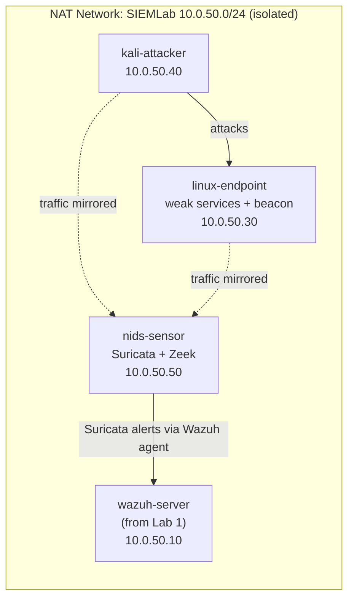

<div align="center">

# 🌐 Network Traffic Analysis Home Lab

**A dedicated IDS sensor that watches an isolated network, catches six attacker techniques on the wire with Suricata and Zeek, feeds its alerts into the Lab 1 Wazuh SIEM, and traces each one back through the packets the way a SOC analyst works.**


[Plan](#-what-this-lab-does) • [Environment](#-the-lab-environment) • [Visibility](#-the-hard-part-seeing-the-traffic) • [Detections](#-detection-coverage) • [Scenarios](#-the-six-scenarios) • [Analysis](#-analysing-the-traffic) • [Wazuh](#-tying-it-back-to-wazuh) • [Reproduce](#-reproduce-this-lab) • [Skills](#-skills-demonstrated)

</div>

---

This is Lab 2 in my cybersecurity home lab series. [Lab 1](https://github.com/jn167/siem-log-analysis-lab) caught attacks from a host's own logs with a Wazuh SIEM. This lab adds the other half of detection: watching the **network itself**. I put a dedicated Suricata and Zeek sensor on the isolated lab network, ran six attacker techniques against my own machines, wrote a custom rule for each, and then opened the captures in Wireshark to read the traffic by hand. The sensor's alerts are shipped into the same Lab 1 Wazuh server, so network detections land next to the host detections from before.

This README is the walkthrough. The [`docs/`](docs/) folder holds the phase-by-phase build guide, [`docs/build-log.md`](docs/build-log.md) is the honest running log, and [`docs/findings.md`](docs/findings.md) holds the analyst write-ups.

> [!NOTE]
> This lab is in progress. The environment, rules, scripts, and documentation are built and the detection logic is validated against generated test traffic. I am currently running the scenarios on the live VMs and adding the screenshots and investigation write-ups as I complete each phase.

---

## 🎯 What This Lab Does

Three ways of seeing the same traffic, each catching things the others miss:

1. **Signature IDS (Suricata).** Rules that match known-bad patterns, with six custom ones I wrote for this lab.
2. **Network metadata (Zeek).** Rich connection logs for hunting behaviour no single signature covers, like C2 beaconing.
3. **Packet analysis (Wireshark / tcpdump).** Opening the raw capture and reading it, the skill everything else rests on.

> [!TIP]
> The payoff of building the labs in order: Suricata's alerts flow into the Lab 1 Wazuh server, so one console shows both host-based detections (Lab 1) and network-based detections (this lab), each mapped to MITRE ATT&CK.

---

## 🖧 The Lab Environment

One new sensor VM joins the three machines from Lab 1, all on the same isolated network.



| Node | Role | OS | vCPU | RAM | IP |
|---|---|---|---|---|---|
| `nids-sensor` | Suricata + Zeek sensor (new) | Ubuntu Server 24.04 LTS | 2 | 4 GB | 10.0.50.50 |
| `wazuh-server` | SIEM from Lab 1 | Ubuntu Server 24.04 LTS | 4 | 8 GB | 10.0.50.10 |
| `linux-endpoint` | Targets + beacon host | Ubuntu Server 24.04 LTS | 1 | 2 GB | 10.0.50.30 |
| `kali-attacker` | Attacker | Kali Linux | 2 | 4 GB | 10.0.50.40 |

> [!IMPORTANT]
> The whole lab lives on an isolated NAT network. The VMs reach each other and the internet, but nothing on my home network can reach them, so the simulated attacks stay fully contained. Every attack script is also scoped in code to `10.0.50.0/24` and refuses any target outside it.

---

## 👁 The Hard Part: Seeing the Traffic

A sensor that just joins the network only sees its own traffic. Getting it to see everyone else's is the part worth understanding, so it gets [its own phase](docs/02-sensor-and-network.md).

- **Promiscuous mode** on the virtual NIC, so it keeps frames addressed to other machines instead of dropping them, plus VirtualBox's **Promiscuous Mode: Allow All** on the adapter so those frames are actually delivered. On real hardware this is a switch SPAN/mirror port.
- **NIC offloading off**, because VirtualBox otherwise hands up giant pre-assembled "packets" with broken checksums that do not match what was really on the wire.

[`scripts/sensor/verify-visibility.sh`](scripts/sensor/verify-visibility.sh) proves it by sniffing a ping between two *other* hosts. That test passing is the gate for the whole lab.

<div align="center">
  <em>[Screenshot: verify-visibility.sh reporting PASS]</em>
</div>

---

## 🛡 Detection Coverage

Six custom Suricata rules in [`configs/suricata/local.rules`](configs/suricata/local.rules), each tied to a MITRE technique and a specific protocol. Every message is prefixed `NTALAB` so the Wazuh rules can pick them out of the alert feed.

| # | SID | Detection | Tactic | Technique | Keys on |
|---|---|---|---|---|---|
| 1 | 1000001 | TCP SYN port scan | Discovery | [T1046](https://attack.mitre.org/techniques/T1046/) | SYN rate from one source |
| 2 | 1000002 | SSH brute force | Credential Access | [T1110.001](https://attack.mitre.org/techniques/T1110/001/) | New-connection rate to port 22 |
| 3 | 1000003 | FTP password in cleartext | Credential Access | [T1040](https://attack.mitre.org/techniques/T1040/) | `PASS` in the FTP stream |
| 4 | 1000004 | HTTP Basic auth in cleartext | Credential Access | [T1040](https://attack.mitre.org/techniques/T1040/) | `Authorization: Basic` header |
| 5 | 1000005 | DNS query with long encoded label | Exfiltration | [T1048](https://attack.mitre.org/techniques/T1048/) / [T1071.004](https://attack.mitre.org/techniques/T1071/004/) | Label length + rate |
| 6 | 1000006 | C2 check-in to raw IP | Command & Control | [T1071.001](https://attack.mitre.org/techniques/T1071/001/) | Request shape, not user-agent |

> [!TIP]
> Rule 1000006 deliberately ignores the User-Agent, because the beacon fakes a normal Chrome UA. It keys on the request shape instead, which is still brittle. That is on purpose: it sets up the Zeek phase, where the durable detection is the beacon's *timing*, not any single packet.

Each rule's logic was validated against generated test captures before going live: all six fire on their own scenario and none fire on matched benign traffic (a normal browse, a handful of SYNs, ordinary DNS).

<div align="center">
  <em>[Screenshot: all six alerts in fast.log / the Wazuh dashboard]</em>
</div>

---

## 💥 The Six Scenarios

Run from `kali-attacker` against `linux-endpoint`, each captured to its own pcap. Scripts are in [`scripts/`](scripts/) and detailed in [`docs/07-traffic-scenarios.md`](docs/07-traffic-scenarios.md).

**1. Port scan** — an nmap SYN scan, the noisy first move. **2. SSH brute force** — Hydra against the Lab 1 `labvictim` account, ending in a real success so the capture shows the failure-burst-then-success pattern. **3 and 4. Cleartext credentials** — logging in to FTP and an HTTP Basic page so the password crosses the wire readable. **5. DNS tunneling** — a file base32-encoded into DNS query labels and leaked to a lab-only DNS server, then rebuilt from the server's log. **6. C2 beaconing** — a compromised host checking in on a jittered interval to a controller.

> [!NOTE]
> Everything is benign by design. The "C2 server" only replies `noop` and runs nothing, the DNS tunnel leaks generated fake records over the reserved `.test` TLD, and the brute-force target and wordlist exist only inside the lab. The point is realistic traffic to detect, not real damage.

> [!WARNING]
> These run only against my own isolated VMs. The techniques are real, so only point tooling like nmap or Hydra at systems you own and control.

---

## 🔬 Analysing the Traffic

The captures are where the learning lands. In Wireshark ([`docs/08-analysis-and-investigations.md`](docs/08-analysis-and-investigations.md)):

- **Follow TCP Stream** on the FTP session reads `USER` / `PASS` in plain text, and the HTTP `Authorization: Basic` header base64-decodes straight to `labadmin:Web-Lab-2026`. The clearest possible argument for TLS.
- The scan shows as one host fanning SYNs across hundreds of ports with no handshakes.
- The DNS tunnel shows as queries with absurd encoded labels; [`scripts/analysis/dns_reassemble.py`](scripts/analysis/dns_reassemble.py) rebuilds the leaked file from the query log, and it matches the original's SHA-256.
- The beacon shows as the same GET repeating on a near-regular interval; [`scripts/analysis/beacon_detect.py`](scripts/analysis/beacon_detect.py) flags it from the Zeek logs by the low variation in its timing, while leaving human-like traffic alone.

Then one capture I **did not** make: a real malware pcap from [malware-traffic-analysis.net](https://www.malware-traffic-analysis.net/training-exercises.html), worked from an IDS alert the way an analyst picks up an unknown capture, identifying the infected host, the C2, and the response. Write-ups are in [`docs/findings.md`](docs/findings.md).

<div align="center">
  <em>[Screenshot: Follow-TCP-Stream showing the cleartext FTP password]</em>
</div>

---

## 🔗 Tying It Back to Wazuh

The sensor runs a Wazuh agent that tails Suricata's `eve.json` and ships it to the Lab 1 manager. Custom rules 100300-100306 ([`configs/wazuh/local_rules_nta.xml`](configs/wazuh/local_rules_nta.xml)) re-score the lab's own signatures and attach the MITRE mapping, so a port scan or a beacon detected on the wire shows up in the same dashboard as Lab 1's host detections, tagged with its technique.

<div align="center">
  <em>[Screenshot: a network alert from nids-sensor in the Wazuh dashboard, mapped to MITRE]</em>
</div>

---

## 📂 Reproduce This Lab

```
configs/
  suricata/     Custom IDS rules (local.rules)
  zeek/         Node, networks, and local.zeek additions
  wazuh/        Rules + agent snippet to ship Suricata alerts into Lab 1 Wazuh
  target/       dnsmasq and Apache config for the weak services
scripts/
  sensor/       NIC prep, visibility check, Suricata/Zeek config, capture
  target/       Weak-service setup and the beacon (run on linux-endpoint)
  kali/         The six attack generators (lab-scoped, benign)
  analysis/     beacon_detect.py and dns_reassemble.py
docs/           Phase-by-phase build guide (01-08), build log, findings
pcaps/          Captures (added as scenarios are run)
screenshots/    Evidence for each phase
```

> [!TIP]
> Start with [`docs/01-overview-and-plan.md`](docs/01-overview-and-plan.md) and work through the numbered phases. [`docs/build-log.md`](docs/build-log.md) tracks how the real run went, troubleshooting included.

---

## 🧰 Tech Stack

**Suricata 7** (signature IDS) · **Zeek 8.0 LTS** (network metadata) · **Wireshark / tcpdump** (packet analysis) · **Wazuh 4.x** (SIEM, from Lab 1) · **VirtualBox 7.1** · **Ubuntu Server 24.04 LTS** · **Kali Linux** with **nmap** and **Hydra** · **MITRE ATT&CK** for technique mapping.

---

## 🎓 Skills Demonstrated

- Deploying a network IDS/NSM sensor (Suricata + Zeek) and giving it full network visibility
- Writing custom Suricata rules across TCP, HTTP, DNS, and FTP, mapped to MITRE ATT&CK
- Detection beyond signatures: finding C2 beaconing by connection-timing analysis of Zeek logs
- Packet analysis in Wireshark: following streams, extracting credentials, tracing DNS tunneling
- Working an unknown real-world malware capture from alert to verdict to response
- Integrating network alerts into a SIEM so host and network detections sit together
- Linux administration, VirtualBox networking, and safe, contained adversary simulation

---

## 🧭 The Home Lab Series

| # | Lab | Focus | Status |
|---|---|---|---|
| 1 | [SIEM & Log Analysis](https://github.com/jn167/siem-log-analysis-lab) | Wazuh, log ingestion, custom detections, dashboards | Complete |
| **2** | **Network Traffic Analysis** | **Suricata, Zeek, Wireshark, packet capture and analysis** | **In progress** |
| 3 | Vulnerability Scanning | Scanning a test network, prioritizing findings | Planned |
| 4 | Incident Response Practice | Simulated incident, timeline, and write-up | Planned |
| 5 | Active Directory Home Lab | Building a small AD domain and studying common attacks | Planned |

---

## 🤝 How I Used AI

I used an AI assistant to help scaffold this lab: drafting rule and script starting points, validating my Suricata rule logic against generated test traffic, and helping organize this documentation. I built, ran, and verified every component myself, and nothing is marked working here until I confirm it in my own environment. Using AI as a force multiplier while verifying its output is how I like to work.

---

<div align="center">
<sub>Built by Justin Nguyen · Pursuing CompTIA A+ and Security+ · Part of an ongoing cybersecurity home lab series.</sub>
</div>
