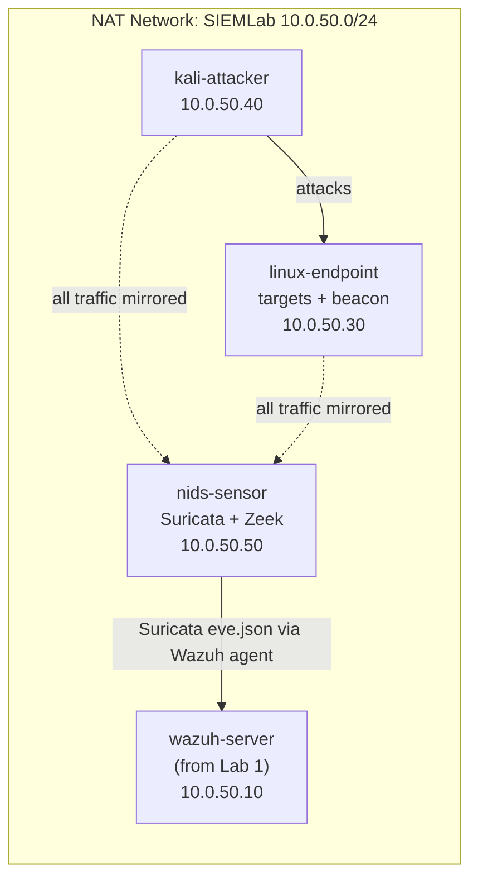

# Phase 1: Overview and Plan

This is Lab 2 in the home lab series. Lab 1 stood up a Wazuh SIEM and caught
attacks from the host's own logs (Sysmon, Windows Security, auth.log). This lab
adds the other half of detection: watching the **network** itself.

The idea is to put a dedicated sensor on the lab network, have it see every
packet, and then detect attacker behaviour three different ways:

1. **Signature IDS (Suricata).** Rules that match known-bad patterns in traffic.
2. **Network metadata (Zeek).** Rich connection logs that let you hunt for
   things no single signature covers, like beaconing.
3. **Packet analysis (Wireshark / tcpdump).** Opening the raw capture and
   reading it by hand, the skill everything else is built on.

Suricata's alerts are then shipped into the **Lab 1 Wazuh** server, so network
detections land in the same console as the host detections from Lab 1. That is
the payoff of building the labs in sequence.

## What gets built

> [!NOTE]
> `nids-sensor` is the one new VM. `wazuh-server`, `linux-endpoint`, and
> `kali-attacker` already exist from Lab 1. `win-endpoint` is not needed here
> and can stay powered off to save host RAM.

## The VMs

| Node | Role | OS | vCPU | RAM | Disk | IP |
|---|---|---|---|---|---|---|
| `nids-sensor` | Suricata + Zeek sensor (new) | Ubuntu Server 24.04 LTS | 2 | 4 GB | 40 GB | 10.0.50.50 |
| `wazuh-server` | SIEM from Lab 1 | Ubuntu Server 24.04 LTS | 4 | 8 GB | 60 GB | 10.0.50.10 |
| `linux-endpoint` | Targets + beacon host | Ubuntu Server 24.04 LTS | 1 | 2 GB | 25 GB | 10.0.50.30 |
| `kali-attacker` | Attacker | Kali Linux | 2 | 4 GB | (prebuilt) | 10.0.50.40 |

> [!IMPORTANT]
> Running the sensor (4 GB) plus the Wazuh server (8 GB) plus two small VMs is
> about 18 GB of RAM committed. If the host is tight, you can run the IDS
> scenarios with the Wazuh server off and still get full Suricata, Zeek, and
> Wireshark results. Only Phase 5 (shipping alerts into Wazuh) needs it on.

## Detection plan

Six scenarios run from `kali-attacker` against `linux-endpoint`, each tied to a
MITRE ATT&CK technique and each with a custom Suricata rule authored in
[`configs/suricata/local.rules`](../configs/suricata/local.rules).

| # | Scenario | Technique | Suricata SID | How it is caught |
|---|---|---|---|---|
| 1 | TCP port scan | [T1046](https://attack.mitre.org/techniques/T1046/) | 1000001 | SYN rate from one source |
| 2 | SSH brute force | [T1110.001](https://attack.mitre.org/techniques/T1110/001/) | 1000002 | New-connection rate to port 22 |
| 3 | FTP cleartext creds | [T1040](https://attack.mitre.org/techniques/T1040/) | 1000003 | `PASS` command in an FTP stream |
| 4 | HTTP Basic creds | [T1040](https://attack.mitre.org/techniques/T1040/) | 1000004 | `Authorization: Basic` header |
| 5 | DNS tunneling | [T1048](https://attack.mitre.org/techniques/T1048/) / [T1071.004](https://attack.mitre.org/techniques/T1071/004/) | 1000005 | Long encoded query labels |
| 6 | C2 beaconing | [T1071.001](https://attack.mitre.org/techniques/T1071/001/) | 1000006 | Check-in shape, plus Zeek timing analysis |

Scenario 6 is deliberately the one a signature handles worst, so it doubles as
the Zeek exercise: [`scripts/analysis/beacon_detect.py`](../scripts/analysis/beacon_detect.py)
finds the beacon by the regularity of its timing in `conn.log`, which is how
you catch a beacon that does not match any signature.

Then one **public malware PCAP** is worked end to end in Phase 8, the way an
analyst picks up a capture they did not generate and has to figure out.

## Phase order

| Phase | Doc | What happens |
|---|---|---|
| 1 | this file | Plan and architecture |
| 2 | [02-sensor-and-network.md](02-sensor-and-network.md) | Build `nids-sensor`, enable traffic mirroring, prove visibility |
| 3 | [03-suricata.md](03-suricata.md) | Install Suricata, load the custom rules |
| 4 | [04-zeek.md](04-zeek.md) | Install Zeek, configure logging |
| 5 | [05-wazuh-integration.md](05-wazuh-integration.md) | Ship Suricata alerts into the Lab 1 Wazuh |
| 6 | [06-target-services.md](06-target-services.md) | Stand up the weak services on `linux-endpoint` |
| 7 | [07-traffic-scenarios.md](07-traffic-scenarios.md) | Run the six scenarios, capture each one |
| 8 | [08-analysis-and-investigations.md](08-analysis-and-investigations.md) | Analyse captures in Wireshark; work a public PCAP |

Work the phases in order. [`docs/build-log.md`](build-log.md) is the running
journal of how the real build went, troubleshooting included, and
[`docs/findings.md`](findings.md) holds the analyst-style write-ups from Phase 8.
